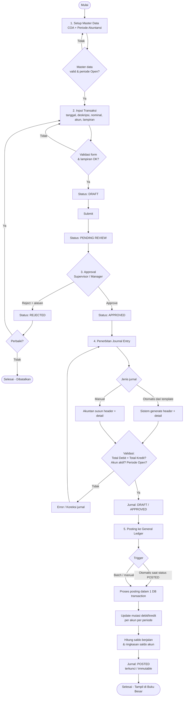
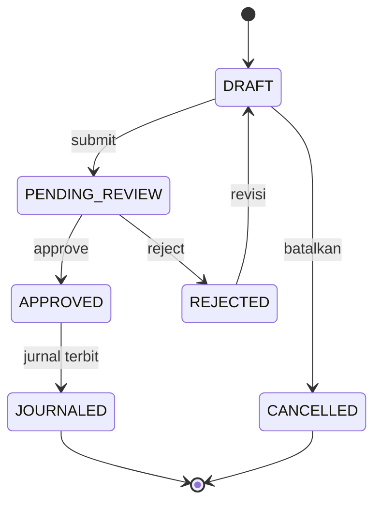
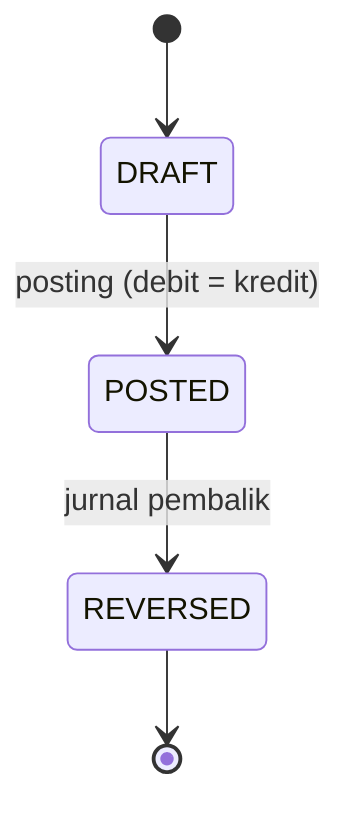
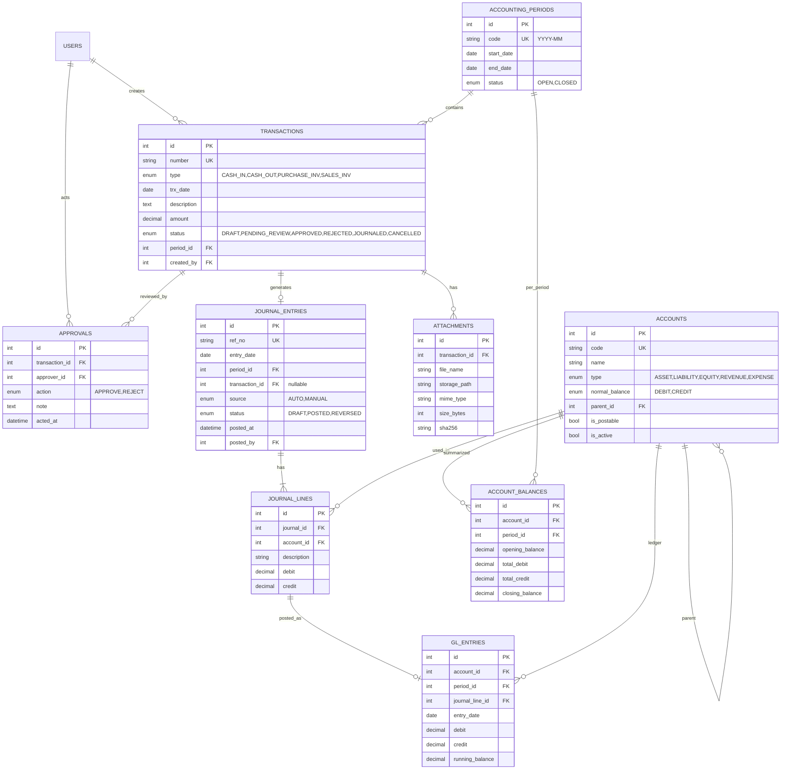
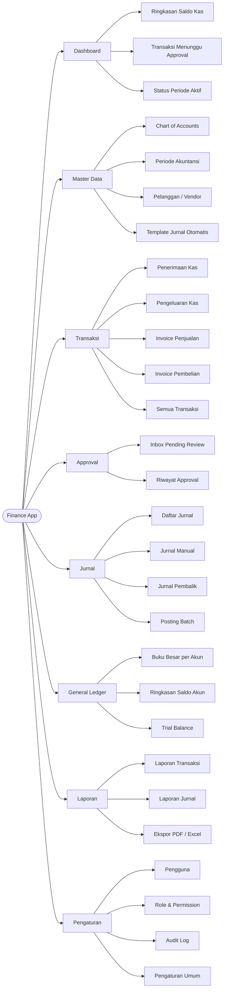

# Rancangan Aplikasi Sistem Keuangan (Input → General Ledger)

## 1. Tujuan & Ruang Lingkup

Aplikasi akuntansi sederhana yang mengalirkan data dari **input transaksi** hingga **General Ledger (Buku Besar)** dalam lima tahap:

1. Setup Master Data
2. Input Transaksi & Lampiran Bukti
3. Approval Flow
4. Penerbitan Journal Entry
5. Posting ke General Ledger

**Di luar ruang lingkup (fase awal):** laporan keuangan lengkap (Neraca, Laba Rugi), pajak, multi-mata-uang, rekonsiliasi bank.

## 2. Aktor & Peran

| Peran | Hak Akses |
|---|---|
| Admin | Kelola Chart of Accounts (COA), periode akuntansi, pengguna |
| Staff Finance (Maker) | Input transaksi, unggah lampiran, submit untuk review |
| Supervisor / Manager Finance (Checker) | Review, Approve / Reject transaksi |
| Akuntan | Review/buat jurnal manual, posting, tutup periode |
| Auditor (read-only) | Lihat transaksi, jurnal, buku besar, audit log |

Prinsip: **segregation of duties** — pembuat transaksi tidak boleh meng-approve transaksinya sendiri.

## 3. Alur Proses Utama (Flowchart)



## 4. Diagram State

### 4.1 Status Transaksi



### 4.2 Status Journal Entry



Jurnal berstatus `POSTED` **tidak boleh diedit/dihapus**; koreksi dilakukan dengan jurnal pembalik (reversal).

## 5. Detail Tiap Tahap

### Tahap 1 — Setup Master Data
- **Chart of Accounts**: kode akun, nama akun, tipe (Aset, Kewajiban, Modal, Pendapatan, Beban), saldo normal (Debit/Kredit), parent akun (hirarki), status aktif, flag *postable* (hanya akun detail yang bisa dijurnal).
- **Periode akuntansi**: format `YYYY-MM`, tanggal mulai/akhir, status `OPEN` / `CLOSED`. Hanya satu atau beberapa periode terbuka yang menerima transaksi.
- **Aturan**: kode akun unik; akun yang sudah punya jurnal tidak boleh dihapus (hanya dinonaktifkan).

Contoh COA:

| Kode | Nama | Tipe | Saldo Normal |
|---|---|---|---|
| 1-1000 | Kas | Aset | Debit |
| 1-2000 | Piutang Usaha | Aset | Debit |
| 2-1000 | Utang Usaha | Kewajiban | Kredit |
| 3-1000 | Modal Disetor | Modal | Kredit |
| 4-1000 | Pendapatan Penjualan | Pendapatan | Kredit |
| 5-1000 | Beban Operasional | Beban | Debit |

### Tahap 2 — Input Transaksi & Lampiran
Jenis transaksi: **Penerimaan Kas, Pengeluaran Kas, Invoice Pembelian, Invoice Penjualan**.

Field: nomor transaksi (auto), jenis, tanggal, deskripsi, nominal, akun terkait, pihak (customer/vendor), lampiran.

Validasi:
- Tanggal harus berada pada periode `OPEN`.
- Nominal > 0; akun wajib dan aktif.
- Lampiran: PDF/JPG/PNG, maks. 5 MB/berkas, dipindai antivirus, disimpan dengan nama acak + hash (SHA-256).
- Wajib minimal 1 lampiran untuk nominal di atas ambang tertentu (konfigurabel).

### Tahap 3 — Approval Flow
- Submit: `DRAFT → PENDING_REVIEW`; transaksi terkunci dari edit.
- Reviewer melihat detail + lampiran, lalu **Approve** atau **Reject** (alasan wajib saat reject).
- Opsional: tingkat approval berdasar nominal (mis. < 10 jt Supervisor, ≥ 10 jt Manager).
- Setiap aksi dicatat di audit log (siapa, kapan, aksi, catatan).

### Tahap 4 — Penerbitan Journal Entry
- **Otomatis**: template pemetaan jenis transaksi → akun.

| Transaksi | Debit | Kredit |
|---|---|---|
| Penerimaan Kas | Kas | Pendapatan / Piutang |
| Pengeluaran Kas | Beban / Utang | Kas |
| Invoice Penjualan | Piutang Usaha | Pendapatan Penjualan |
| Invoice Pembelian | Beban / Persediaan | Utang Usaha |

- **Manual**: Akuntan menyusun jurnal (penyesuaian, koreksi).
- **Header**: nomor referensi (auto, mis. `JV-2026-10-0001`), tanggal, periode, deskripsi, status, sumber (transaksi/manual), pembuat.
- **Detail**: kode akun, deskripsi, debit, kredit (satu baris hanya salah satu terisi).
- **Validasi wajib**: `SUM(debit) = SUM(kredit)` (presisi persis, gunakan `DECIMAL`, bukan float), minimal 2 baris, akun aktif & postable, periode `OPEN`.

### Tahap 5 — Posting ke General Ledger
- **Trigger**: otomatis saat jurnal `POSTED`, atau tombol "Post Batch" (opsional terjadwal via Laravel Scheduler).
- **Proses (atomic, satu DB transaction)**:
  1. Kunci (lock) baris jurnal; pastikan belum diposting (idempotent).
  2. Untuk tiap detail: tambah mutasi debit/kredit ke `gl_account_balances` per (akun, periode).
  3. Hitung saldo akhir: `akhir = awal + debit − kredit` (akun saldo normal debit) atau `awal + kredit − debit` (saldo normal kredit).
  4. Tulis `gl_entries` (buku besar per baris) dengan saldo berjalan.
  5. Set jurnal `POSTED`, simpan `posted_at`, `posted_by`.
- Gagal di tengah → rollback penuh.
- **Output**: Buku Besar per akun (saldo awal, mutasi, saldo berjalan, saldo akhir) dan ringkasan saldo seluruh akun (trial balance sederhana: total debit = total kredit).

## 6. Rancangan Basis Data (ERD)



Constraint penting:
- `JOURNAL_LINES`: `CHECK (debit >= 0 AND credit >= 0 AND (debit = 0 OR credit = 0))`.
- `ACCOUNT_BALANCES`: unik `(account_id, period_id)`.
- Semua kolom uang bertipe `DECIMAL(18,2)`.

## 7. Diagram Urutan (Sequence)

```mermaid
sequenceDiagram
    actor Staff
    actor Manager
    participant UI as Web UI
    participant API as Backend API
    participant DB as Database
    participant ST as File Storage

    Staff->>UI: Isi form transaksi + lampiran
    UI->>API: POST /transactions
    API->>ST: Simpan lampiran
    API->>DB: Insert transaksi (DRAFT)
    Staff->>API: POST /transactions/{id}/submit
    API->>DB: Status = PENDING_REVIEW
    Manager->>API: POST /transactions/{id}/approve
    API->>DB: Status = APPROVED + audit log
    API->>API: Generate jurnal, validasi debit = kredit
    API->>DB: Insert journal_entries + lines
    API->>DB: BEGIN; update account_balances & gl_entries; jurnal = POSTED; COMMIT
    API-->>UI: Jurnal terposting
```

## 8. Rancangan API (Ringkas)

| Method | Endpoint | Fungsi |
|---|---|---|
| GET/POST/PUT | `/accounts` | Kelola COA |
| GET/POST/PATCH | `/periods` | Kelola & tutup periode |
| POST | `/transactions` | Buat transaksi (DRAFT) |
| POST | `/transactions/{id}/attachments` | Unggah lampiran |
| POST | `/transactions/{id}/submit` | Ajukan review |
| POST | `/transactions/{id}/approve` · `/reject` | Keputusan approval |
| POST | `/journals` | Jurnal manual |
| POST | `/journals/{id}/post` | Posting ke GL |
| POST | `/gl/post-batch` | Posting batch |
| GET | `/gl/accounts/{id}?period=` | Buku besar per akun |
| GET | `/gl/summary?period=` | Ringkasan saldo semua akun |

## 9. Aturan Bisnis & Keamanan

1. Debit = Kredit pada setiap jurnal (ditolak sistem jika tidak seimbang).
2. Jurnal `POSTED` immutable; koreksi via reversal.
3. Tidak ada transaksi/jurnal/posting pada periode `CLOSED`.
4. Maker ≠ Checker.
5. Audit log untuk semua perubahan status.
6. Role-based access control (RBAC) di setiap endpoint.
7. Validasi tipe & ukuran berkas; simpan di luar web root; unduh via URL bertoken.
8. Posting idempotent dan transaksional (cegah posting ganda).
9. Nomor referensi dibuat atomik (sequence) agar tidak ada duplikat.

## 10. Rancangan Layar (UI)

- **Master Data**: daftar & form COA, daftar periode.
- **Transaksi**: daftar (filter status), form input + unggah lampiran, detail.
- **Approval Inbox**: daftar *Pending Review*, panel detail + tombol Approve/Reject.
- **Jurnal**: daftar, form jurnal manual (indikator selisih debit–kredit real-time).
- **Buku Besar**: pilih akun + periode → mutasi & saldo berjalan; ringkasan saldo per akun.

### 10.1 Struktur Menu Aplikasi



### 10.2 Daftar & Jumlah Menu

Total: **8 menu utama** dan **28 submenu**.

| # | Menu Utama | Jumlah Submenu | Submenu | MVP |
|---|---|:-:|---|:-:|
| 1 | Dashboard | 3 | Ringkasan Saldo Kas, Transaksi Menunggu Approval, Status Periode Aktif | ✔ |
| 2 | Master Data | 4 | Chart of Accounts, Periode Akuntansi, Pelanggan/Vendor, Template Jurnal Otomatis | ✔ (tanpa Pelanggan/Vendor) |
| 3 | Transaksi | 5 | Penerimaan Kas, Pengeluaran Kas, Invoice Penjualan, Invoice Pembelian, Semua Transaksi | ✔ |
| 4 | Approval | 2 | Inbox Pending Review, Riwayat Approval | ✔ |
| 5 | Jurnal | 4 | Daftar Jurnal, Jurnal Manual, Jurnal Pembalik, Posting Batch | ✔ |
| 6 | General Ledger | 3 | Buku Besar per Akun, Ringkasan Saldo Akun, Trial Balance | ✔ |
| 7 | Laporan | 3 | Laporan Transaksi, Laporan Jurnal, Ekspor PDF/Excel | Ditunda |
| 8 | Pengaturan | 4 | Pengguna, Role & Permission, Audit Log, Pengaturan Umum | ✔ (tanpa Role & Permission) |

**Cakupan MVP:** 7 menu utama dan 23 submenu. Yang ditunda ke fase berikutnya: menu Laporan (3 submenu), Pelanggan/Vendor, dan Role & Permission (di MVP role cukup berupa kolom `role` pada tabel user).

### 10.3 Detail Fungsi Setiap Submenu

**1. Dashboard**

| Submenu | Penjelasan |
|---|---|
| Ringkasan Saldo Kas | Kartu saldo akun kas/bank saat ini dan total pemasukan/pengeluaran periode aktif. |
| Transaksi Menunggu Approval | Jumlah dan daftar singkat transaksi berstatus *Pending Review* (tautan ke Inbox). |
| Status Periode Aktif | Menampilkan periode berjalan, statusnya (Open/Closed), dan jumlah jurnal belum diposting. |

**2. Master Data**

| Submenu | Penjelasan |
|---|---|
| Chart of Accounts | CRUD akun: kode, nama, tipe, saldo normal, parent (hirarki), flag *postable*, aktif/nonaktif. Akun yang sudah dipakai hanya bisa dinonaktifkan. |
| Periode Akuntansi | Buat periode (`YYYY-MM`), atur tanggal mulai/akhir, buka dan tutup periode. |
| Pelanggan / Vendor | CRUD data pihak ketiga (nama, kontak, alamat, NPWP opsional) untuk invoice penjualan/pembelian. |
| Template Jurnal Otomatis | Atur pemetaan jenis transaksi ke akun debit/kredit default yang dipakai saat jurnal otomatis dibuat. |

**3. Transaksi**

| Submenu | Penjelasan |
|---|---|
| Penerimaan Kas | Form uang masuk: tanggal, deskripsi, nominal, akun sumber, lampiran. Status awal *Draft*. |
| Pengeluaran Kas | Form uang keluar: tanggal, deskripsi, nominal, akun beban/utang, lampiran. |
| Invoice Penjualan | Form tagihan ke pelanggan: pelanggan, tanggal, jatuh tempo, nominal, lampiran. |
| Invoice Pembelian | Form tagihan dari vendor: vendor, tanggal, jatuh tempo, nominal, lampiran. |
| Semua Transaksi | Daftar seluruh transaksi dengan filter jenis/status/periode/tanggal; aksi lihat, edit (Draft/Rejected), submit, batalkan. |

**4. Approval**

| Submenu | Penjelasan |
|---|---|
| Inbox Pending Review | Daftar transaksi menunggu keputusan; detail + lampiran; tombol **Approve** / **Reject** (alasan wajib saat reject). |
| Riwayat Approval | Log keputusan yang sudah diambil: siapa, kapan, aksi, catatan. |

**5. Jurnal**

| Submenu | Penjelasan |
|---|---|
| Daftar Jurnal | Semua jurnal (otomatis & manual) dengan filter status/periode/sumber; lihat header dan baris detail. |
| Jurnal Manual | Form header + baris detail (akun, deskripsi, debit, kredit) dengan indikator selisih debit–kredit real-time; tidak bisa disimpan jika tidak seimbang. |
| Jurnal Pembalik | Membuat jurnal pembalik dari jurnal *Posted* (debit/kredit ditukar) untuk koreksi; jurnal asli berstatus *Reversed*. |
| Posting Batch | Pilih beberapa jurnal belum diposting lalu posting sekaligus; menampilkan hasil sukses/gagal per jurnal. |

**6. General Ledger**

| Submenu | Penjelasan |
|---|---|
| Buku Besar per Akun | Pilih akun + periode: saldo awal, daftar mutasi debit/kredit, saldo berjalan, saldo akhir; tautan ke jurnal sumber. |
| Ringkasan Saldo Akun | Tabel semua akun: saldo awal, total debit, total kredit, saldo akhir per periode. |
| Trial Balance | Neraca saldo; memastikan total debit = total kredit seluruh akun. |

**7. Laporan** *(ditunda setelah MVP)*

| Submenu | Penjelasan |
|---|---|
| Laporan Transaksi | Rekap transaksi per jenis/status/periode. |
| Laporan Jurnal | Rekap jurnal per periode/sumber/status. |
| Ekspor PDF / Excel | Unduh laporan dalam format PDF atau CSV/Excel. |

**8. Pengaturan**

| Submenu | Penjelasan |
|---|---|
| Pengguna | CRUD pengguna, atur peran, aktif/nonaktif, reset password. |
| Role & Permission | Atur hak akses per peran secara dinamis (*ditunda*; MVP memakai kolom `role` tetap). |
| Audit Log | Riwayat perubahan data dan status (siapa, kapan, aksi, nilai lama/baru); hanya baca. |
| Pengaturan Umum | Nama perusahaan, format nomor referensi, ambang nominal wajib lampiran/approval bertingkat, batas ukuran lampiran. |

### 10.4 Matriks Akses Menu per Peran

| Menu | Admin | Staff Finance | Supervisor/Manager | Akuntan | Auditor |
|---|:-:|:-:|:-:|:-:|:-:|
| Dashboard | ✔ | ✔ | ✔ | ✔ | ✔ |
| Master Data | ✔ (CRUD) | Lihat | Lihat | Lihat | Lihat |
| Transaksi | Lihat | ✔ (CRUD) | Lihat | Lihat | Lihat |
| Approval | – | – | ✔ | – | Lihat |
| Jurnal | Lihat | – | Lihat | ✔ (CRUD, Post) | Lihat |
| General Ledger | Lihat | – | Lihat | ✔ | Lihat |
| Laporan | ✔ | – | ✔ | ✔ | ✔ |
| Pengaturan | ✔ | – | – | – | Audit Log saja |

## 11. Tech Stack

Arsitektur **monolith Laravel 13** (server-side rendering, satu codebase untuk UI dan backend), dirancang **sesederhana mungkin untuk deploy**: hanya butuh PHP + MySQL, **tanpa Redis**, tanpa service tambahan.

| Lapisan | Pilihan |
|---|---|
| Framework | Laravel 13 (monolith, MVC) |
| Bahasa | PHP (versi minimum sesuai persyaratan Laravel 13) |
| Frontend | Blade + Tailwind CSS (Vite, di-build sekali saat deploy); interaktivitas ringan dengan Alpine.js |
| Database | **MySQL** (InnoDB, tipe `DECIMAL(18,2)` untuk nominal) |
| Session, cache, queue | **Driver `database`** (tanpa Redis) |
| Auth | Laravel Breeze (session-based) |
| RBAC | Laravel Gates & Policies (kolom `role` pada user, tanpa paket tambahan) |
| Storage lampiran | Laravel Filesystem disk `local` privat (`storage/app/private`), unduh via controller dengan otorisasi |
| Posting batch | Dijalankan sinkron lewat tombol "Post Batch"; opsional Laravel Scheduler via 1 entri cron |
| Audit log | Tabel `audit_logs` sendiri (observer/service), tanpa paket tambahan |
| Ekspor | `barryvdh/laravel-dompdf` (PDF) dan CSV bawaan PHP; Excel opsional |
| Testing | Pest / PHPUnit |

### 11.1 Prinsip Deploy Sederhana

- **Satu server** (VPS atau shared hosting yang mendukung PHP) dengan Nginx/Apache + PHP-FPM + MySQL.
- **Tanpa queue worker/Supervisor**: pekerjaan berjalan sinkron di request; volume transaksi kecil sehingga cukup.
- **Tanpa Redis/Memcached**: `SESSION_DRIVER=database`, `CACHE_STORE=database`, `QUEUE_CONNECTION=sync`.
- **Tanpa Node di server produksi**: aset di-build lokal/CI, folder `public/build` ikut di-upload.
- Langkah deploy:
  1. Upload kode (git pull atau zip) dan `composer install --no-dev --optimize-autoloader`.
  2. Salin `.env` (isi koneksi MySQL, `APP_ENV=production`, `APP_DEBUG=false`).
  3. `php artisan key:generate` (sekali), `php artisan migrate --force`.
  4. `php artisan storage:link`, lalu `php artisan config:cache route:cache view:cache`.
  5. (Opsional) cron: `* * * * * php artisan schedule:run` untuk posting batch terjadwal.
- Backup: `mysqldump` terjadwal + salin folder `storage/app/private` (lampiran).

Pemetaan konsep ke Laravel:
- **Approval & status**: Enum PHP + model state transition di Service class.
- **Posting GL**: `PostingService` dijalankan dalam `DB::transaction()` dengan `lockForUpdate()`.
- **Validasi debit = kredit**: FormRequest + pengecekan di model sebelum `POSTED`.
- **Nomor referensi**: tabel sequence dengan `lockForUpdate()` (InnoDB) agar atomik.
- **Periode tertutup**: Policy/middleware yang menolak penulisan pada periode `CLOSED`.

## 12. Rencana Implementasi

| Fase | Cakupan | Hasil |
|---|---|---|
| 1 | Setup proyek, auth/RBAC, master data (COA, periode) | Master data berfungsi |
| 2 | Modul transaksi + lampiran | Input transaksi & unggah bukti |
| 3 | Approval flow + audit log | Alur Draft → Approved/Rejected |
| 4 | Journal entry (otomatis & manual) + validasi seimbang | Jurnal terbit |
| 5 | Posting GL, saldo per periode, laporan buku besar | GL & ringkasan saldo |
| 6 | Pengujian, hardening, dokumentasi | Rilis awal |

## 13. Kriteria Penerimaan

- [x] COA dan periode dapat dikonfigurasi.
- [x] Transaksi dengan lampiran dapat dibuat dan disubmit.
- [x] Approve/Reject berjalan dengan alasan dan audit log.
- [x] Jurnal tidak seimbang ditolak sistem.
- [x] Posting memperbarui saldo akun per periode dan Buku Besar secara akurat.
- [x] Jurnal terposting tidak dapat diubah; reversal tersedia.
- [x] Total debit = total kredit pada ringkasan saldo seluruh akun.

_Diverifikasi 17 Oktober 2026 — lihat [docs/LAPORAN_FUNCTIONAL_TEST.md](docs/LAPORAN_FUNCTIONAL_TEST.md) bagian 7._
